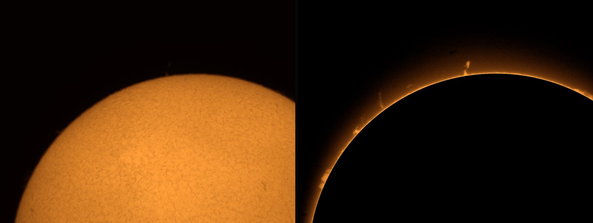

<p align="center">
  <picture>
    <source media="(prefers-color-scheme: dark)" srcset="docs/img/logo-mark-dark.svg">
    
  </picture>
</p>

<h1 align="center">RustFlare</h1>

<p align="center">
  <a href="https://github.com/ddompe/rustflare/actions/workflows/ci.yml"></a>
  <a href="https://github.com/ddompe/rustflare/releases/latest"></a>
  <a href="https://ddompe.github.io/rustflare/manual/"></a>
</p>

<p align="center">
  <br>
  <sub>One cycle of a prominence recording, straight from a RustFlare session in H-alpha (colour added for display): the disc lane (left) and the long-exposure lane with the coronagraph mask (right).</sub>
</p>

Headless, web-controlled **solar and planetary imaging** in Rust (planetary includes the Moon). Run it on a Raspberry Pi next to the telescope, open a web page from your phone or laptop (an iPhone Home Screen app works well), and take the Sun (or the Moon, or a planet) from "where is it?" to a saved recording without a keyboard. It began as a solar tool and the Sun is still the best-supported target. The installed version is shown in the corner of the status bar.

## Features

**Mount** (ZWO AM3 family over USB or Bluetooth; iOptron CEM70 series and the HAE69C over USB; a simulator)
- **Go to Sun** (and the Moon, Mars, Jupiter and Saturn): slews to the target's current position from your site and the Pi's clock, then switches on tracking at the solar, lunar or sidereal rate. **Send home**, **Search home** (iOptron), a slew pad with remembered speed (the speeds come from the mount's driver), and the state the mount itself reports (it follows changes made with the mount's own buttons).
- **Find my mount** asks each serial port which mount answers. **Mount time and place** reads the mount's own site and clock, compares them with the Pi's and can send the Pi's (by itself on connecting, if you leave that on): the HAE69C has no clock battery and restarts from 2017-01-01.
- USB re-enumeration and Bluetooth link loss are detected; the mount is found again automatically.

**Cameras** (Player One, and ZWO ASI through the vendor library, which is loaded at run time; a simulator)
- **Frame size (ROI)**: read out the centre 75/50/25 % of the sensor for a much higher frame rate (57 fps full frame, 153 fps at 50 % on the Apollo-M MINI over USB 3).
- Exposure, gain, offset and 8/16-bit with a logarithmic exposure slider, histogram with clipping warning (separate red, green and blue curves for a colour camera), sensor temperature, device datasheet card with a photo, and HCG and unity gain marks under the gain slider where the catalog knows them.
- **Cooler, fan and anti-dew heater** for ZWO ASI cooled cameras (for example the ASI533MC Pro), with a gentle warm-up before switching off.
- Colour cameras: a colour live view with white balance; recordings stay raw (undemosaiced).
- **Darks** (cap on, same exposure and gain) and **flats**: guided workflow (cap on, check level, capture), automatic exposure to about 50 %, master flat applied to the live view (recordings stay raw) and remembered across restarts.

**What are you imaging?** A **profile** (Sun in H-alpha or white light, Moon, Planet, Other) adapts the words, the target the tracker looks for, the expected size, the meridian flip target and the FITS `OBJECT`; what does not apply is greyed with its reason, never hidden. **Optical setups** (one dropdown and a Manage dialog) remember a telescope with its Barlow or reducer, pixel size, profile, flat and dark.

**Tracking and guiding**
- Follows the **full disc**, a **partial disc** (fitted from the visible limb, with the expected radius from your optics and a measured fallback) or a **surface feature** such as a sunspot.
- Automatic calibration of both mount axes, then a guider that corrects **slow drift only**: it averages away the seeing, uses a dead band and gentle pulses. All parameters are adjustable.

**Live view**
- A fixed screen that never scrolls: the picture, a **Start** strip (Start and Snap, with one line saying what the recording keeps), five tabs, and a **Tools** sheet on the picture (zoom, prominence view, stretch, overlays, widgets, display). **Hide controls** leaves only the picture. A **Set up N of 5** strip walks through the first session.
- Draggable, semi-transparent **overlays**: camera/screen/disk fps, exposure, gain, temperature, mount state, flat applied, recording, RAM buffer, guiding error graph, histogram.
- Centring aids (bullseye, Sun outline), zoom, brightness/contrast/gamma, auto-stretch, H-alpha tint.
- **Prominence view**: a software coronagraph that blacks out the disc so you can judge the exposure for prominences. **Prominence pair** capture saves a disc frame, a longer exposure and their composite; the **+ Prominence** recording saves both as raw lanes.
- **Focus assist**: a sharpness score and its history while you turn the focuser by hand.

**Recording**
- **Single frames, sequences and scheduled bursts** ("100 frames every 30 s"), **HDR lanes** and a **+ Prominence** lane recording, as **SER** videos, **PNG** or **FITS** files, through a **RAM buffer** so a slow disk never limits a fast camera; choose to wait for the disk or **drop frames** when the buffer is full. Pause and resume, and an optional "send the mount home when finished".
- **After each burst**: *Keep video*, *Video + stack*, *Stack only* or *Best frames + stack*, with a separate low-priority stacker program (mono cameras; the stacker restarts itself if it stops).
- **USB drive** selection with free-space and FAT32 safeguards (4 GB files continue in numbered parts), a **safe eject** button, and recording to the Pi's own SD card with a reserve kept free.
- A full-screen **file manager** (**Files** in the header): a folder tree, stacks as a thumbnail grid, check recordings (frame count, measured fps, brightness; flags *mostly dark* and *incomplete*), download a file or a whole folder as a `.tar`, delete in bulk, re-stack.

**Running it**
- Installs and upgrades as a Debian package (a `.deb` from the releases page, or the signed apt repository; releases are made by pushing a tag, a build from your own checkout is installed with `scripts/pi-deploy.sh`); settings (site, optical setups, flats, guiding, storage, UI layout) survive reboots; auto-reconnect of camera and mount.
- **User guide** with screenshots: [docs/guide/](docs/index.md), published at https://ddompe.github.io/rustflare/manual/. Start with [Getting started](docs/guide/getting-started.md); problems are covered in [Troubleshooting](docs/guide/troubleshooting.md).
- **Field Wi-Fi hotspot** (`rustflare-hotspot`) for use without a network, with an automatic way back to the previous Wi-Fi ([docs/guide/hotspot.md](docs/guide/hotspot.md)).
- Opt-in **session log** (what the tracker and guider saw, plus small frames) and a replay test harness for building regression fixtures from real sessions.
- Optional **password** and **HTTPS** with a private certificate authority you trust once on your phone (`rustflare-tls`).
- Built-in simulators for the camera and mount (including a Moon, a planet and a cooled colour camera), so everything can be tried without hardware; Playwright browser tests (phone and desktop) run in CI.

Based on ideas and code from [Vidoxide](https://github.com/GreatAttractor/vidoxide) (MIT), see [NOTICE.md](NOTICE.md).

## Install on a Raspberry Pi

From a release package:

```sh
# https://github.com/ddompe/rustflare/releases/latest
sudo apt install ./rustflare_*_arm64.deb
sudo apt install ./rustflare_*_arm64.deb   # later: download the newer .deb and run this again
```

Or from the signed apt repository (see [docs/guide/updating.md](docs/guide/updating.md)):

```sh
curl -fsSL https://ddompe.github.io/rustflare/rustflare.gpg | sudo tee /usr/share/keyrings/rustflare.gpg >/dev/null
echo "deb [signed-by=/usr/share/keyrings/rustflare.gpg arch=arm64] https://ddompe.github.io/rustflare stable main" | sudo tee /etc/apt/sources.list.d/rustflare.list
sudo apt update && sudo apt install rustflare
```

Then open `http://<pi-name>.local:8080/`. For HTTPS and a password see [docs/guide/phone-setup.md](docs/guide/phone-setup.md). Details in [docs/guide/getting-started.md](docs/guide/getting-started.md); how to use it in the [tour of the screen](docs/guide/screen.md).

## Status

Developed against a Raspberry Pi 5, a Player One Apollo-M MINI, a ZWO ASI174MM Mini, a ZWO AM3 and an iOptron HAE69C.

| Area | State |
|---|---|
| ZWO AM3 over USB and Bluetooth: connect, tracking, nudge, send home, Go to Sun | **Verified on the real mount** |
| Capture path: camera and USB stick on separate USB 3 controllers (~57 fps at 1944x1472, 3.4 GB sequence) | **Verified on the Pi** |
| Storage, 4 GB FAT32 split, camera settings restore, package install and upgrade | **Verified on the Pi** |
| Flats, guider on a real sky, prominence tools, USB recovery, iPhone app, HTTPS on the phone | Built and tested on the simulators; **waiting for a real-hardware check** ([checklist](docs/project/hardware-checklist.md)). Tracking on real H-alpha images, safe eject, focus assist and the coronagraph lanes have been run on the Sun and are listed there |
| iOptron HAE69C over USB: connect (model code `0066`), slews, home, search home, tracking, the mount's site and time | **Verified on a real mount**: slews, Send home, Search home, tracking, site and time (replies take 300 to 600 ms). Guiding and Go to Sun after a time sync are still to be checked |
| ZWO ASI174MM Mini: open, controls, frames | **Verified on the Pi on a USB 2 port** (8.7 fps at 16-bit); the USB 3 frame rate is not measured |
| ZWO ASI cooler, fan and anti-dew; ASI colour cameras; the Moon and Planet profiles; optical setups on a real telescope | Built and tested on the simulators (and a fake SDK); **waiting for the real device** |

See [docs/project/roadmap.md](docs/project/roadmap.md) for the plan and milestones.

## Quick try (no hardware)

```sh
cd web && npm install && npm run build && cd ..
cargo run --release -p rustflare-server        # http://localhost:8080
```

In the UI: open the *simulated camera*, connect the *simulator* mount, enable solar tracking, start tracking, calibrate, centre. `scripts/smoke.sh` does the same through the API.

## Documentation

Start at [docs/index.md](docs/index.md) (`mkdocs serve` renders it): a user guide, a reference and developer material. Design decisions are in [docs/adr](docs/adr/README.md).

## Security

By default there is **no password** and the server can slew a mount: use a trusted network, or set a password and enable HTTPS ([docs/guide/phone-setup.md](docs/guide/phone-setup.md)). It is built for a telescope on a LAN, not for exposure to the internet.
