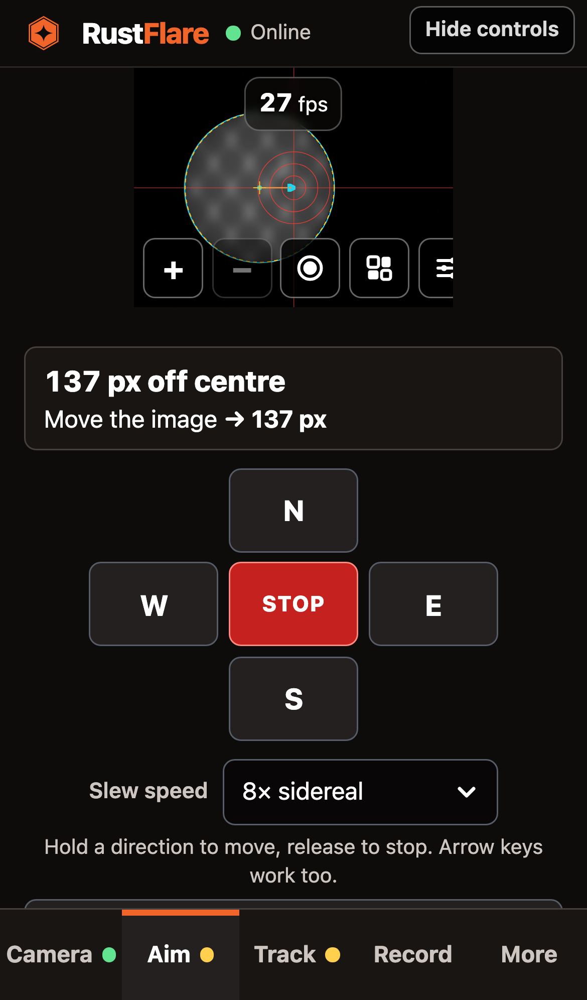
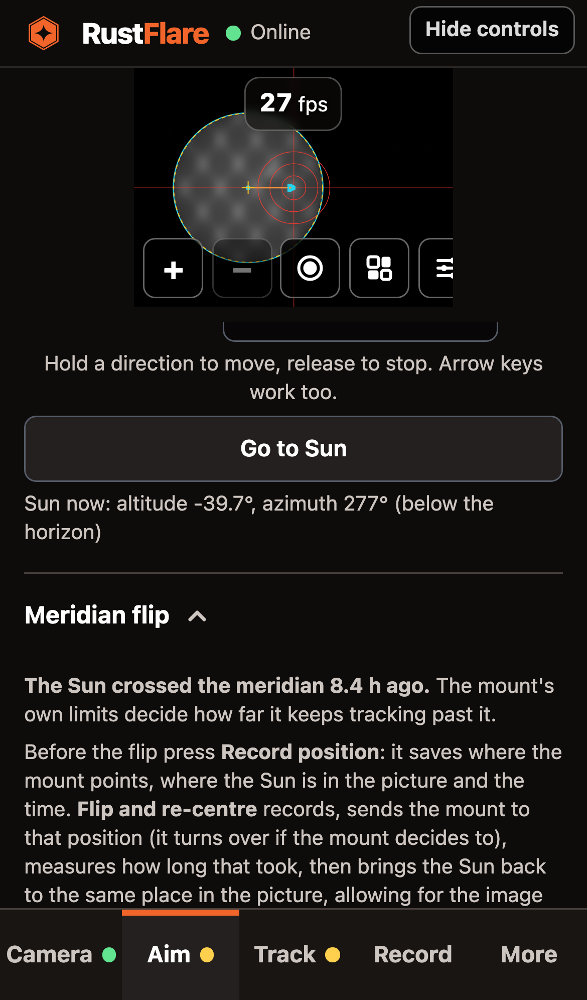

# Aim tab

## Connect the mount

Choose USB or Bluetooth and connect. For Bluetooth, close the ZWO phone app first and press the mount's pairing button, then use *Scan for mounts*. The state tags show the link and what the mount reports. See [Troubleshooting](troubleshooting.md#mount-bluetooth-does-not-connect).

## Go to Sun

**Go to Sun** sends your site and the time to the mount, slews to where the Sun is now and then switches on solar tracking by itself. It asks for confirmation, and **STOP** cancels. It needs:

- your site set in [More > Site](more.md#site),
- the Sun above the horizon,
- a Pi clock that is synchronised (it warns you if not).

### The Moon and the bright planets

The selector above the button lists the Sun, Moon, Mars, Jupiter and Saturn with their altitude now ("Saturn · 34° up", or "below horizon"). Pick one and the button reads *Go to Saturn*; the rest is the same: confirmation, **STOP** cancels, and tracking starts on arrival at the **lunar** rate for the Moon and the **sidereal** rate for planets (the Sun gets the solar rate). The selector always starts at the Sun, so the button cannot surprise you.

- **Below the horizon:** the confirmation warns and the button changes to *Go anyway* (the Sun is never approached below the horizon). Under 15 degrees it warns about trees, buildings and poor seeing.
- **Accuracy:** positions are computed on the Pi (planets from approximate orbital elements, the Moon from a short series with parallax for your site), good to a few arcminutes. That puts the target in the field of a narrow camera; centre it by hand with the N/S/E/W pad.
- The Moon is large: with a long focal length you see only part of it, so aim for the limb or a crater and use short exposures.

**Send home** goes to the mount's home position, with confirmation.

## Move by hand

The N/S/E/W pad moves the mount while held; release to stop. Arrow keys work too. The slew speed is remembered. **STOP** always cancels motion. The *Solar tracking* switch follows what the mount itself reports.

## Meridian flip

Aim tab > Meridian flip. The panel shows how long until the Sun crosses the meridian (it needs the site set).

**Flip automatically** does it for you. About 5 minutes before the meridian it records where the mount points and where the Sun sits in the picture; about 1 minute after the meridian (or as soon as the mount stops tracking by itself) it:

1. **pauses a running recording** (it resumes by itself after a clean flip),
2. sends the mount to the recorded pointing, which turns it over,
3. switches solar tracking on and brings the Sun back to its recorded place, allowing for the image turning 180 degrees,
4. recalibrates the guider if it was guiding, and goes back to guiding.

The status bar and the **Meridian flip** overlay say which step it is on. Both timings can be changed under the switch. If anything goes wrong the recording is *not* resumed and the status bar says why.

Without the automatic mode:

- **Record position** saves the pointing, the Sun's place and the time.
- **Flip and re-centre** does the same steps as above on demand.
- **Restore after a manual flip** does the re-centring after you flipped with another app.

A [guider calibration](track.md#calibrate) is needed for the re-centring. How far the mount keeps tracking past the meridian is the mount's own setting (ZWO app). If it stops, it stops tracking at its limit and the Sun drifts away, so flip before that. A plain *Go to Sun* sent after the meridian also makes the mount turn over; expect to centre the Sun by hand afterwards, because the mount's pointing is less accurate on the other side. The image then turns by about 180 degrees: recalibrate.

!!! note "Status"
    Built and tested on the simulator. The first real flip is still to be done (see the [hardware checklist](../project/hardware-checklist.md)). On 2026-11-22 the mount turned over on a Go to Sun after it had stopped at its limit, and the calibration afterwards showed the image rotated by about 209 degrees.
