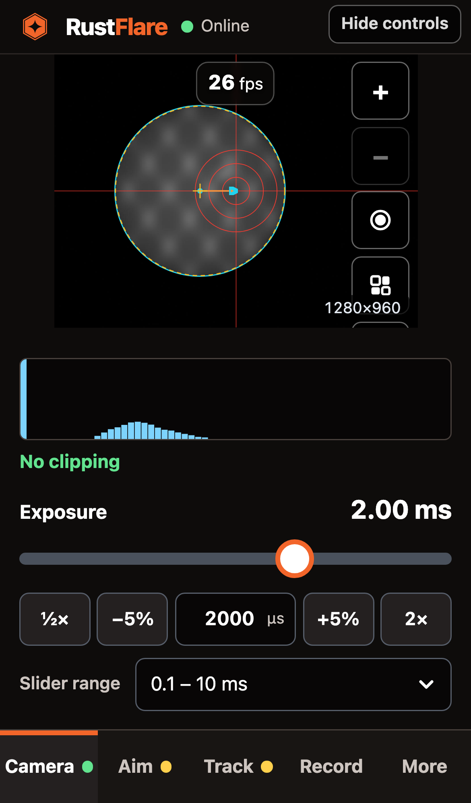

# Camera tab

Open the camera, then set up the picture.

## Exposure and gain

Exposure and gain take typed values or the slider. The exposure slider is logarithmic, so a few milliseconds are easy to hit. You can also choose the bit depth.

Use the **histogram**: the bright part of the disc should sit clear of the right edge. A *Clipping* warning means too much exposure or gain.

## Frame size

**Frame size** reads out only the centre 75, 50 or 25 % of the sensor. That gives a higher frame rate for the same USB bandwidth, for example about 150 fps instead of 57 on one Player One camera (see [Performance](../reference/performance.md)). Tracking restarts when you change it.

## Flats

1. Press *Start flats*.
2. Put the flat cap or a diffuser on and check the level.
3. Press *Capture*.

The exposure is found automatically (about 50 % of full scale). The master flat is written and applied to the live view, and the overlay shows *Flat: applied*. Recordings stay raw. A switch turns the correction on or off, and the master flat is remembered across restarts. Details: [Capture formats](../reference/capture-formats.md#flats).

## Darks

Cap on, the same exposure and gain as on the Sun, then *Capture darks*. The master dark is subtracted from the live view (before the flat). The overlay shows *Dark: applied*, or *mismatch* if the camera's settings changed since. Recordings stay raw.

## Colour cameras

Colour cameras show a colour live view (half resolution) with white balance (Camera tab > Colour: **Auto** makes the bright disc neutral, **Manual** sets red and blue gains, **Off** shows the sensor's own colours). A single-frame PNG from a colour camera is saved twice: `..._raw.png` (the mosaic) and a debayered, white-balanced 16-bit colour `.png`. Recordings stay raw (undemosaiced, with the Bayer pattern in the file), which is what stacking software such as AutoStakkert, PIPP and Siril expects. Do not use hardware binning with a colour camera. See [Capture formats](../reference/capture-formats.md#colour-cameras).

## Reconnecting

*reconnect camera & mount* makes RustFlare reopen the last devices after a restart. See [Getting started](getting-started.md#what-the-service-does-by-itself).

## Focus assist

Camera tab > Focus assist helps you focus by hand, which is hard to judge by eye on a bright day. Switch it on and turn the focuser slowly. A **score** appears over the live image together with a small **history graph**, and again in the Camera tab with a larger graph, the best score so far and how long ago you reached it.

- The score is a sharpness measure of the bright part of the picture around the Sun (the limb and surface detail). It does not change with exposure or gain.
- Seeing makes single frames jump, so every second of frames is summarised by the mean of its **sharpest quarter** (lucky imaging). One point of the graph is one such second.
- Turn towards the highest point of the line, pass it, and come back to the dashed **best** line. A peak you pass and return to is the focus. **Reset history** starts a new session, for example after changing the filter.
- Keep solar tracking on so the Sun stays in the same place, and keep the Sun in view with the cap off. If nothing bright is in view the panel says so.
- The simulator has a *Sim defocus* control for trying it without a telescope.

Status: tested on the simulator; the score has not yet been tuned on real solar data (see the hardware checklist).
