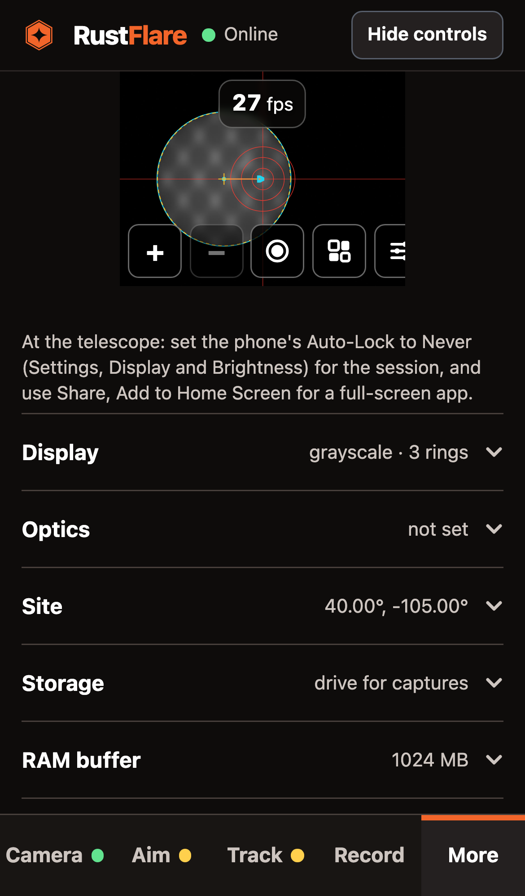

# More tab

Settings you change rarely.

## Site

Type your latitude and longitude in degrees, east positive (a site west of Greenwich has a negative longitude), and save. It stays on the Pi and is used by **Go to Sun**. The section also shows whether the Pi's clock is synchronised to a time server, which Go to Sun needs.

*Use this device's location* works only over HTTPS (browsers share location only on secure pages), see [Phone setup](phone-setup.md).

## Optics

Enter the telescope's native focal length and, if you use one, the Barlow or reducer factor. RustFlare shows the effective focal length, the image scale and how large the Sun should be in pixels, and tells you when the measured Sun disagrees.

## Storage

Pick the drive for captures (a USB stick appears automatically) and press *Use*; the choice is remembered. It shows free space and the recording time left at the current frame rate.

- A removed drive is never silently replaced by the SD card: recording refuses to start until it is back.
- FAT32 sticks work, but a file cannot exceed 4 GB, so long recordings continue in `_part2`, `_part3` files.
- Use a USB 3 (blue) port for the stick and a different blue port for a USB 3 camera, so they do not share a controller.
- **Eject drive safely** flushes and unmounts the stick (and powers it off) before you pull it.

## Display

Stretch, brightness, contrast, gamma, tint, bullseye and the overlays. See [The screen](screen.md#overlays).

## Guiding settings

How strongly the guider corrects. See [Track](track.md).

## Session log

An opt-in log of what the tracker and guider saw, plus small frames. Useful when reporting a problem. It writes into a `logs` folder on the capture drive and stops at 200 MB. Nothing identifying is logged.

## Updates

Shows the installed version and whether a newer one exists. See [Updating](updating.md).
