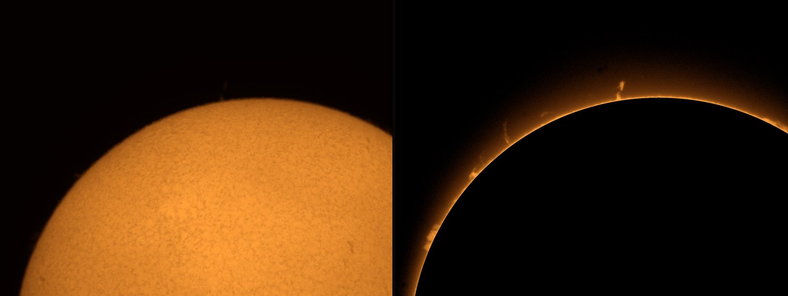

# Record tab

Frames go into a RAM buffer and are written to disk in the background, so the camera does not slow down for the disk until the buffer is full. Under **After each burst** you can also have each burst stacked from memory, and choose whether the video is kept: see [After each burst](recording-modes.md).

## What to record

One form covers everything you record. Pick the kind at the top:

- **Sequence**: frames at the current exposure, stopped by frame count and/or duration. Fill in **Repeat every (s)** to turn it into repeated recordings, for example "100 frames every 30 s" (start to start), with a number of repeats (blank means until you press Stop). Live view and guiding keep running between repeats.
- **+ Prominence**: two lanes alternate, the disc at your current exposure and a longer exposure (a multiple you choose) for the prominences. Nothing is combined or stretched: every lane and cycle is its own short raw SER video in its own folder, inside a `prominence_...` session folder, ready for lucky-imaging stacks that become the frames of a time-lapse. Turn on **Coronagraph** to get a black disc on the prominence stacks: both lanes are saved raw, the Sun's position is saved with every frame of the prominence lane, and the stacker draws the black disc on the finished stack (it needs the Sun in view; the disc is found in the stack itself, so it does not jump around).
- **HDR lanes**: for eclipses and the Moon. Define 2 to 6 lanes, each with a name, exposure, optional gain and a frame count (presets for partial phase, diamond ring and totality). They are cycled in order for the number of cycles you give; "Repeat a cycle every" sets a steady time-lapse cadence. Every lane and cycle is its own short raw video in an `hdr_...` session folder, one sub-folder per lane. Stack each video into one frame; the stacks of a lane, in cycle order, make a time-lapse, and the lanes merge into HDR frames.

*One cycle of a prominence recording, straight from a RustFlare session in H-alpha (colour added for display): the disc lane (left) and the long-exposure lane with the coronagraph mask (right).*

For both lane kinds your exposure and gain are restored at the end, and the frames right after each exposure change are discarded. The file manager shows these sessions as their own kinds, with a per-lane list and a filter.

**Stills** (below the form): a single frame as PNG, and the prominence pair, a disc PNG, a long-exposure PNG and a composite for a quick look. Judge the exposure first with the [Prominence view](screen.md#prominence-view). For data you will process, use the + Prominence recording instead.

## When will it end, and sending the mount home

With a number of repeats or cycles set (or a single recording), the Record tab shows **Ends about HH:MM (in 1 h 12 min)** under the plan, from the frame rate and exposures; while it records, the progress shows the same estimate from what has really happened. It is approximate: a recording that runs until you stop it has no end time.

**Send the mount home when the recording finishes** (a switch above *File format*, off by default, needs the mount connected): when the recording ends by itself, guiding stops and the mount slews to its home position, which suits an unattended plan. Stopping the recording, pausing it, or an error never moves the mount, and it does nothing for a recording that runs until stopped. Keep the cables and counterweight clear.

## Pause, resume and stop

While a sequence or lane recording runs, **Pause recording** (on this tab, and on the bar under the picture on the other tabs) stops writing and remembers what was left: the cycles or bursts not yet done. **Resume recording** carries on with them in new files in the same style, named `…-resumed`. **Discard** forgets the paused recording. **Stop recording** ends it for good.

The automatic [meridian flip](aim.md#meridian-flip) pauses a running recording the same way and resumes it by itself after a clean flip (files named `…-after-flip`).

## Format

- **SER** video (default), **PNG** or **FITS**. PNG and FITS write one file per frame into a folder. FITS headers carry time, exposure, gain and instrument.
- *When the RAM buffer is full*: **Wait for the disk** never loses a frame (a fast camera slows to disk speed). **Drop frames** keeps the camera at full speed and counts the dropped frames, shown in the buffer overlay and the notes file; a recording that lost frames also leaves a message in the status bar until you dismiss it.

The buffer size (default 1 GB) is set here. The panel shows whether a burst fits and the disk load of the schedule. File layout and sizes: [Capture formats and storage](../reference/capture-formats.md).

## Flats and darks

These are captured from the [Camera tab](camera.md#flats). Recordings always stay raw.

## Files (file manager)

**Files** shows the whole drive one folder at a time. The path across the top (**Drive › stacks › 2026-11-22**) takes you back up; on a wide screen a folder tree sits beside the list.

- **Where things are:** each day's recordings are in a folder named for the day. Finished stacks are in **stacks**, grouped by the day of their recording, with a thumbnail, how many frames were kept and whether a dark or flat was applied. Logs and debug files are in **logs**.
- **Recording ↔ stack:** a recording that has been stacked shows **Stacked ✓ show**, which jumps to its stack. A stack says which recording it came from.
- **Download .tar** on a folder (or **Download this folder** in the bar) gives you everything in it as one file that macOS, Windows and Linux open directly. It is streamed from the Pi, so nothing extra is written to the drive. Folders other than `stacks` are refused while a recording is running.
- **Stack thumbnails:** in a folder of stacks the **Thumbnails** view (the default) shows a grid. Tap one for a larger preview with **Previous**, **Next** (or the arrow keys) and a download button; the preview is stretched for display, the FITS has the data. Tick the corner box to select. **List** shows rows with the details instead. A folder shows 120 items at a time with **Show more**.
- **Download selection:** with items ticked, **Download n selected items** gives just those as one `.tar`.
- **Check** reads a recording's header and samples frames: size, frame count, measured fps, duration and brightness. It flags **Mostly dark** (cap left on, or the Sun out of view) and **Incomplete** (cut off). **Check recordings** does every recording in the folder.
- **Filter** narrows the folder by name; **Sort** by name, newest or largest.
- **Delete** works on files and folders (several at once) and asks first, with the number of files and the size. It removes the notes file too. The day folders, `stacks` and `logs` themselves, and the stacker's `manifest.json`, cannot be deleted. Deleting a stack does not make the stacker redo it.

## Safe eject

Use **Eject drive safely** (More > Storage) before pulling a USB drive. It is refused while recording.
