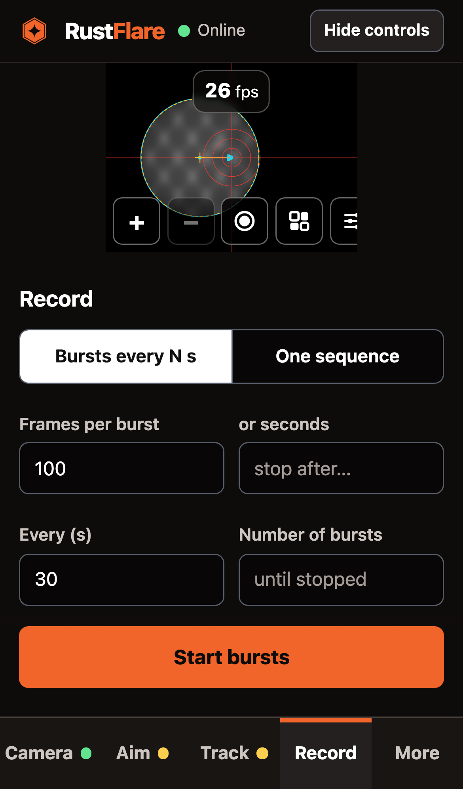

# Record tab

Frames go into a RAM buffer and are written to disk in the background, so the camera does not slow down for the disk until the buffer is full.

## What to record

One form covers everything you record. Pick the kind at the top:

- **Sequence**: frames at the current exposure, stopped by frame count and/or duration. Fill in **Repeat every (s)** to turn it into repeated recordings, for example "100 frames every 30 s" (start to start), with a number of repeats (blank means until you press Stop). Live view and guiding keep running between repeats.
- **+ Prominence**: two lanes alternate, the disc at your current exposure and a longer exposure (a multiple you choose) for the prominences. Nothing is combined or stretched: every lane and cycle is its own short raw SER video in its own folder, inside a `prominence_...` session folder, ready for lucky-imaging stacks that become the frames of a time-lapse. Turn on **Coronagraph** to black out the Sun's disc in the saved frames of the prominence lane (the disc lane stays raw; it needs the Sun in view).
- **HDR lanes**: for eclipses and the Moon. Define 2 to 6 lanes, each with a name, exposure, optional gain and a frame count (presets for partial phase, diamond ring and totality). They are cycled in order for the number of cycles you give; "Repeat a cycle every" sets a steady time-lapse cadence. Every lane and cycle is its own short raw video in an `hdr_...` session folder, one sub-folder per lane. Stack each video into one frame; the stacks of a lane, in cycle order, make a time-lapse, and the lanes merge into HDR frames.

For both lane kinds your exposure and gain are restored at the end, and the frames right after each exposure change are discarded. The file manager shows these sessions as their own kinds, with a per-lane list and a filter.

**Stills** (below the form): a single frame as PNG, and the prominence pair, a disc PNG, a long-exposure PNG and a composite for a quick look. Judge the exposure first with the [Prominence view](screen.md#prominence-view). For data you will process, use the + Prominence recording instead.

## Pause, resume and stop

While a sequence or lane recording runs, **Pause recording** (on this tab, and on the bar under the picture on the other tabs) stops writing and remembers what was left: the cycles or bursts not yet done. **Resume recording** carries on with them in new files in the same style, named `…-resumed`. **Discard** forgets the paused recording. **Stop recording** ends it for good.

The automatic [meridian flip](aim.md#meridian-flip) pauses a running recording the same way and resumes it by itself after a clean flip (files named `…-after-flip`).

## Format

- **SER** video (default), **PNG** or **FITS**. PNG and FITS write one file per frame into a folder. FITS headers carry time, exposure, gain and instrument.
- *When the RAM buffer is full*: **Wait for the disk** never loses a frame (a fast camera slows to disk speed). **Drop frames** keeps the camera at full speed and counts the dropped frames, shown in the buffer overlay and the notes file.

The buffer size (default 1 GB) is set here. The panel shows whether a burst fits and the disk load of the schedule. File layout and sizes: [Capture formats and storage](../reference/capture-formats.md).

## Flats and darks

These are captured from the [Camera tab](camera.md#flats). Recordings always stay raw.

## Captures (file manager)

**Captures** lists what you recorded, by day.

- **Check** reads a recording's header and samples frames: size, frame count, measured fps, duration and brightness. It flags **Mostly dark** (cap left on, or the Sun out of view) and **Incomplete** (cut off).
- **Download** and **Delete** work per capture. Delete asks for confirmation and removes the notes file too.
- You can check or delete several at once.

## Safe eject

Use **Eject drive safely** (More > Storage) before pulling a USB drive. It is refused while recording.
