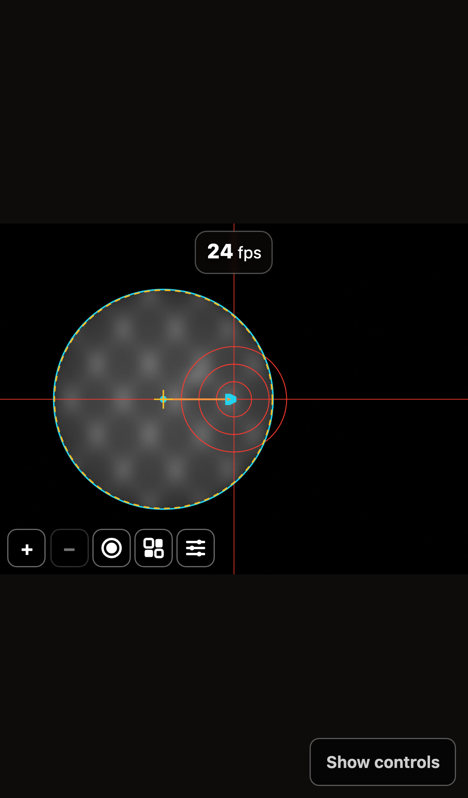

# The screen

The **live view** is on top with its overlays. The five **tabs** are at the bottom and the controls of the selected tab sit in between. The tabs follow a session:

1. [Camera](camera.md): open the camera, set exposure and gain, flats and darks.
2. [Aim](aim.md): connect the mount, Go to Sun, meridian flip.
3. [Track](track.md): follow the Sun and correct drift.
4. [Record](record.md): single frames, sequences, bursts, files.
5. [More](more.md): display, site, storage, session log, updates.

A dot on a tab shows whether that step is ready (green), needs attention (yellow) or has not been started.

## Overlays

Overlays sit on the picture, are semi-transparent and can be dragged anywhere. Tap one to shrink it to one line. The grid button in the picture's tool column switches each one on or off and sets their opacity.

- **Status**: camera fps, screen fps (the preview rate your phone receives), disk MB/s while recording, exposure, gain, sensor temperature, mount state, and whether a flat or dark is applied.
- **Recording** and **RAM buffer**: appear while recording.
- **Guiding**: the average error and a one-minute graph while guiding.
- **Histogram**.

The slider button opens display settings: auto-stretch, brightness, contrast, gamma, colour tint and bullseye. These change only what you see, never what is recorded.

## Prominence view

The round **Prominence view** button in the picture's tool column blacks out the Sun's disc (display only). Raise exposure or gain and watch the faint structure at the limb appear, so you can judge the exposure you want for prominences. It does not stretch the image, so what you see is the real brightness. Turn on *Auto-stretch* in the display settings if you want it brightened. [Record > Prominence pair](record.md#prominence-pair) then captures the disc and a longer exposure together.

## Hide controls

**Hide controls** (top right) hides the header, the panel and the tabs so only the live view and its tools remain. **Show controls** brings them back. Rotate the phone to landscape for the largest picture, and pinch to zoom.

## Problems

A red banner shows the last problem (camera error, lost target, storage unavailable, mount error, lost mount link). See [Troubleshooting](troubleshooting.md).

## Header: STOP, theme and Hide controls

With a mount connected, a red **STOP** in the header stops the mount from any tab. The sun or moon button switches between the night theme (dark, easy on dark-adapted eyes) and a **daylight theme** (light, high contrast, for bright sun on a phone screen); the image stays black in both. **Hide controls** shows the image only.
