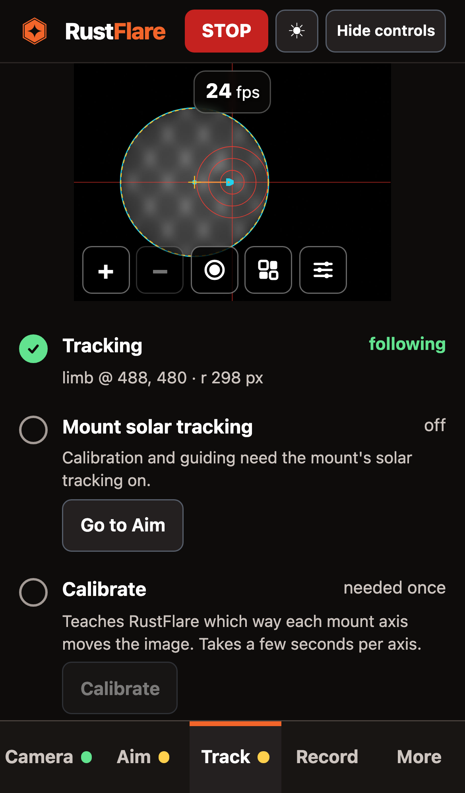

# Track tab

!!! note "Screenshot"
    The picture is from 2026-11-21 and shows the older wording of the tracker choices. The text is current.

The mount's own tracking follows the Sun's rate. RustFlare's tracker watches the picture and its guider corrects the slow drift that is left. It does not try to correct seeing.

## Choose what to follow

- **Disc edge**: the default. Works for a whole or a partial disc as long as some limb is in view.
- **Feature**: when the field is entirely on the disc, tap a sunspot, filament or plage to follow it.
- **Full disc**: when the whole disc is in the frame (the centroid of the disc).
- **Planet centroid**: the brightest small disc on a dark sky, for the Planet [profile](profiles.md). With the Planet profile the disc-edge and full-disc choices are greyed with their reason.

The live view shows the target (red rings) and where the Sun is (cyan), with the correction arrow. More about the modes in [Tracking and guiding](../reference/tracking-and-guiding.md).

## Calibrate

**Calibrate** teaches RustFlare which way each mount axis moves the image. While it runs the button becomes **Stop calibration** (it ends the calibration and stops the mount at once). If it fails, the Calibrate step says why in plain words (the picture did not move along two different directions: check that the Sun is in view and the mount is tracking) and offers **Retry**. The same text is in the status bar, which shows two lines and opens in full when tapped. While holding, an *Off target by N px* line says what to do, with **Stop guiding and recalibrate**. It needs the mount's solar tracking on. Do it once, and again after rotating the camera, after a meridian flip, or periodically in alt-az mode.

## Hold position

Press **Hold position** to keep the target where it is now; *Centre the disc instead* (**Centre and hold**) moves it to the middle of the frame first. *Guiding settings* tune how strongly it corrects. Guiding needs a calibration.

## If it loses the Sun

- *No Sun found*: too dark (raise exposure) or no limb in view. Use the anchor tracker.
- *Target lost* (after 2 seconds of failures, so a passing shadow does not count): the status bar says so. If guiding had been running long enough to learn how the mount drifts (about a minute), it **goes on from that drift** to keep the framing, for up to 15 minutes; otherwise guiding pauses. Either way it resumes by itself when the limb is back.
- **A shadow or thick cloud that darkens the picture** (to less than a quarter of its usual light with the exposure unchanged) is treated as the Sun being lost at once: nothing is measured, the Sun model is not fed, and guiding carries on from the last position measured while the picture was bright, using the drift it has learned. (Before 0.6.2 the limb fit read edges in the noise and the guider followed a false position.)
- Shadows and thin cloud: the Sun position is a smoothed model that ignores measurements that jump, and the picture of the Sun outline, the tracking and the coronagraph mask all use that one model.

## Optics

If the measured Sun size disagrees with what you entered in [More > Optics](more.md#optical-setup), the app shows the real focal length or Barlow factor and offers *Use measured*.
