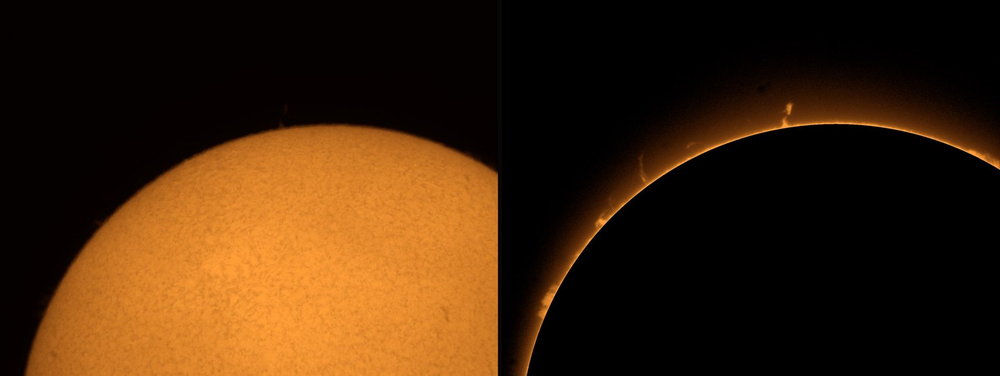

# RustFlare

*One cycle of a prominence recording, straight from a RustFlare session in H-alpha (colour added for display): the disc lane (left) and the long-exposure lane with the coronagraph mask (right).*

RustFlare is headless solar and planetary imaging for a Raspberry Pi (planetary includes the Moon; the Sun is the best-supported target). It runs next to your telescope and you control it from the web browser on your phone: live view, Go to the Sun, Moon or a planet, tracking and guiding, and recording in SER, FITS or PNG.

This site has three parts.

## 1. User guide

For the person using the app at the telescope. Task by task, in plain language. The screenshots on the tab pages are from 2026-11-21 and are older than the text.

- [Getting started](guide/getting-started.md): install on the Pi and connect from the phone
- [The screen](guide/screen.md): the live view, the Tools sheet, overlays, the Start strip and **Hide controls**
- The tabs: [Camera](guide/camera.md), [Aim](guide/aim.md), [Track](guide/track.md), [Record](guide/record.md), [More](guide/more.md)
- [What are you imaging (profiles)](guide/profiles.md): Sun, Moon, planets
- [After each burst](guide/recording-modes.md) and [Stacking](guide/stacking.md): video, stacks, or both
- [Setting up the Pi](guide/pi-setup.md): the capture drive, memory, services
- [Phone setup](guide/phone-setup.md): HTTPS, password, Home Screen app
- [Field networking](guide/hotspot.md): the Pi as a Wi-Fi hotspot
- [Updating](guide/updating.md)
- [Troubleshooting and FAQ](guide/troubleshooting.md)

## 2. Reference

Look-up material: what hardware works, what the files contain, settings and numbers.

- [Hardware](reference/hardware.md): supported cameras and mounts
- [Capture formats and storage](reference/capture-formats.md), [File formats](reference/file-formats.md)
- [Device images](reference/device-images.md): the photos in the device catalog
- [Tracking and guiding concepts](reference/tracking-and-guiding.md)
- [Configuration](reference/configuration.md): settings and environment files
- [HTTP API](reference/api.md), [Debugging and logs](reference/debugging.md)
- [Performance](reference/performance.md)

## 3. Developer and project

For people working on RustFlare itself. You do not need any of this to use it.

- [Architecture](project/architecture.md), [Development guide](project/development.md)
- [Decisions (ADRs)](adr/README.md)
- [ZWO mount Bluetooth protocol notes](project/zwo-ble-protocol.md)
- [Roadmap and status](project/roadmap.md), [Next-round plan](project/next-round.md)
- [Hardware verification checklist](project/hardware-checklist.md)
- [Performance audit](project/performance-audit.md), [UI review](project/ui-review.md)
- [Maintainer setup of the apt repository](project/apt-repository.md)
- [Brand](project/brand.md)
