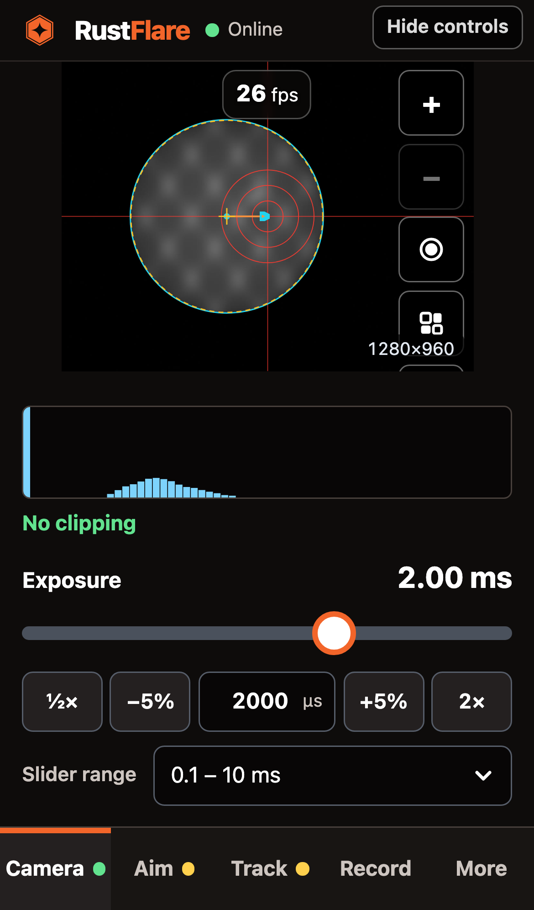
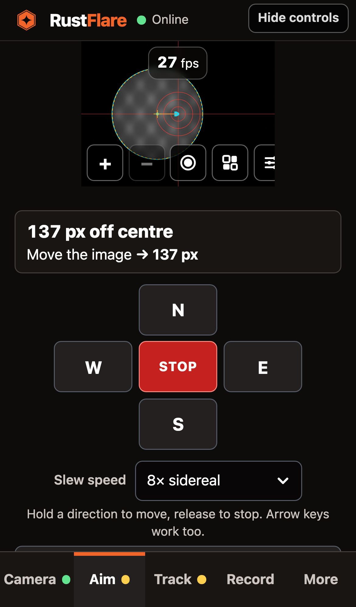
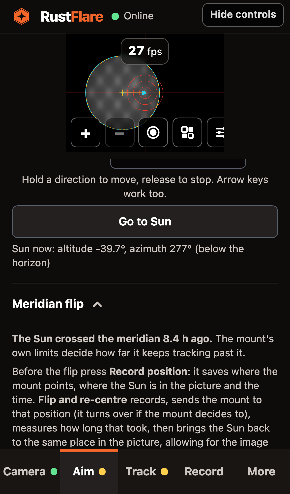
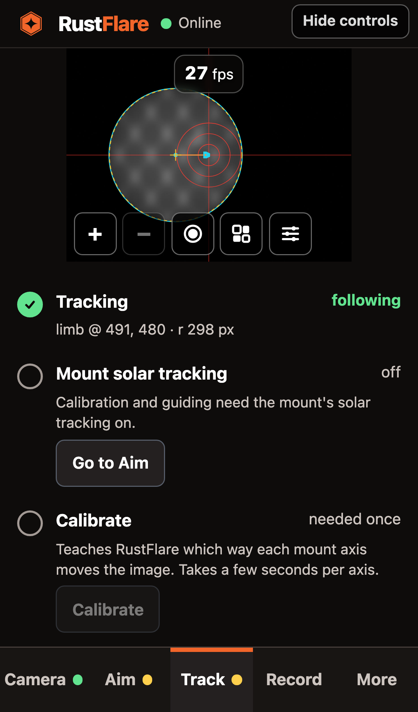
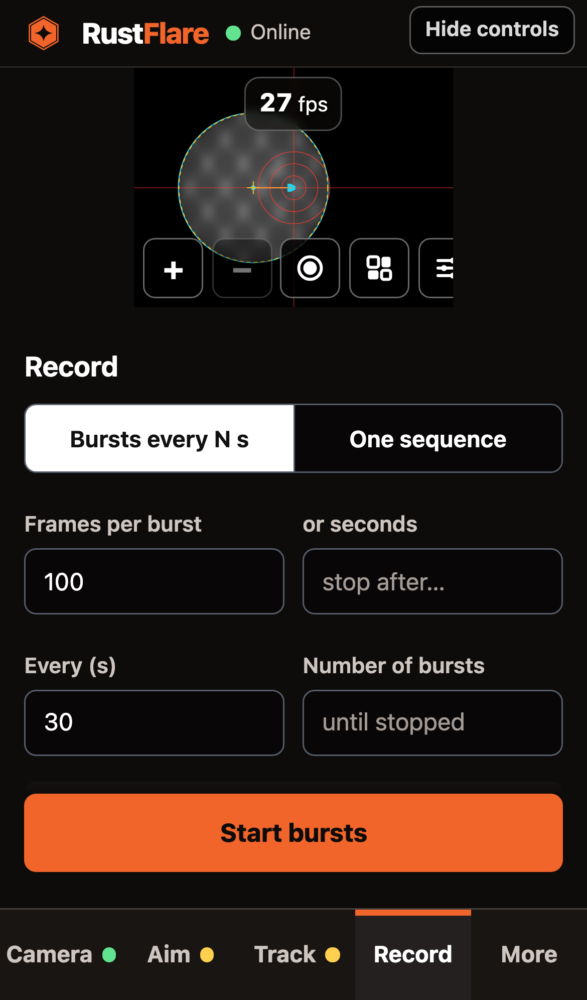
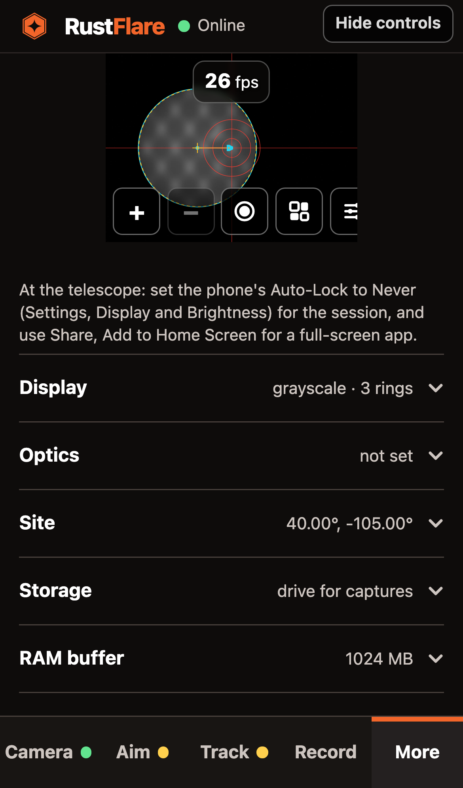
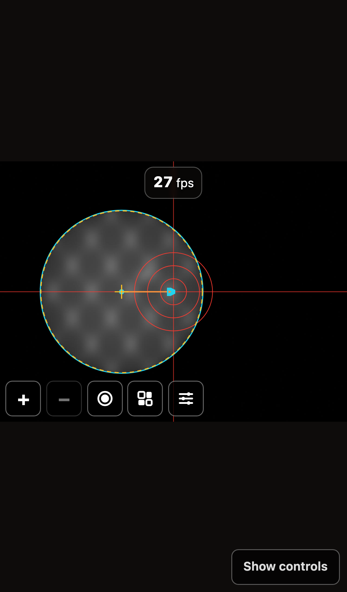

# RustFlare user manual

RustFlare runs on a Raspberry Pi next to the telescope and is controlled from a phone or computer browser. This is a tour of the screen in the order you use it. Details live in the [user guide](usage.md); install steps are in [getting started](getting-started.md). The screenshots were captured automatically from the simulator with Playwright (`web/e2e/manual-shots.mjs`), so they match the current interface.

## Open it

On the phone, join the same Wi-Fi (or the Pi's [hotspot](hotspot.md)) and open `http://astropi.local:8080`. If HTTPS is set up the page walks you through trusting the certificate once ([HTTPS and password](https.md)). Add it to the Home Screen for a full-screen app.

The five tabs at the bottom follow a session: **Camera, Aim, Track, Record, More**. A dot on a tab shows whether that step is ready (green), needs attention (yellow), or has not been started.

## 1. Camera

Open the camera, then set exposure and gain (the exposure slider is logarithmic), bit depth, and **Frame size** (read out only the centre 75, 50 or 25 % of the sensor for a higher frame rate). Flat and dark calibration live here too; the live view shows when they are applied.

## 2. Aim

Connect the mount, then **Go to Sun**: it sets the site and time on the mount, slews to the Sun and turns solar tracking on. Make sure the Pi's clock is synchronised and the site is set (More > Site), or the Sun position will be wrong. The pad moves the mount by hand; hold a direction, release to stop. **STOP** always cancels motion.

### Meridian flip

The panel shows how long until the Sun crosses the meridian. **Record position** remembers where the mount points and where the Sun is in the picture. **Flip and re-centre** sends the mount back to that pointing after it turns over, then brings the Sun to the same place in the image, allowing for the image rotating 180 degrees. See [the user guide](usage.md#meridian-flip-assist).

## 3. Track

Choose what to follow (limb or disc centre), calibrate the guider once, and start guiding. The live view shows the target (red rings) and where the Sun is (cyan), with the correction arrow.

## 4. Record

Record SER, PNG or FITS sequences, single stills, or bursts, to the Pi's card or an attached drive. The file manager checks, downloads and deletes captures. Use **Safe eject** before pulling a USB drive.

## 5. More

Display (stretch, overlays, Prominence view), site and clock, guiding settings, session log, storage and updates.

## See the image bigger

**Hide controls** (top right) hides the header, panel and tabs so only the live view and its tools remain; **Show controls** brings them back. Rotate the phone to landscape for the largest picture, and pinch to zoom.
