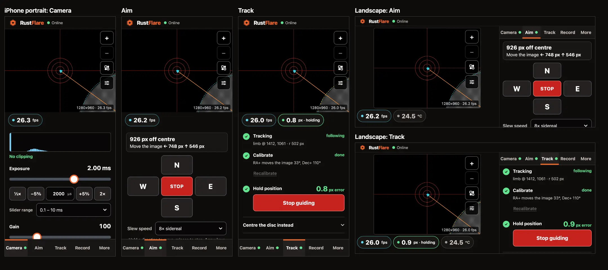
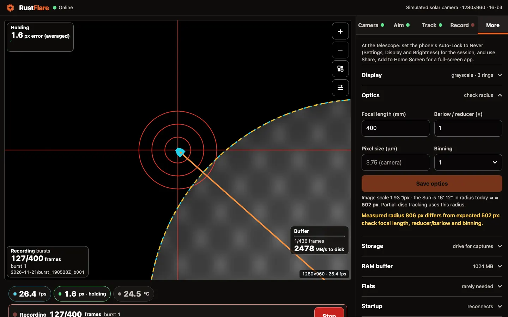
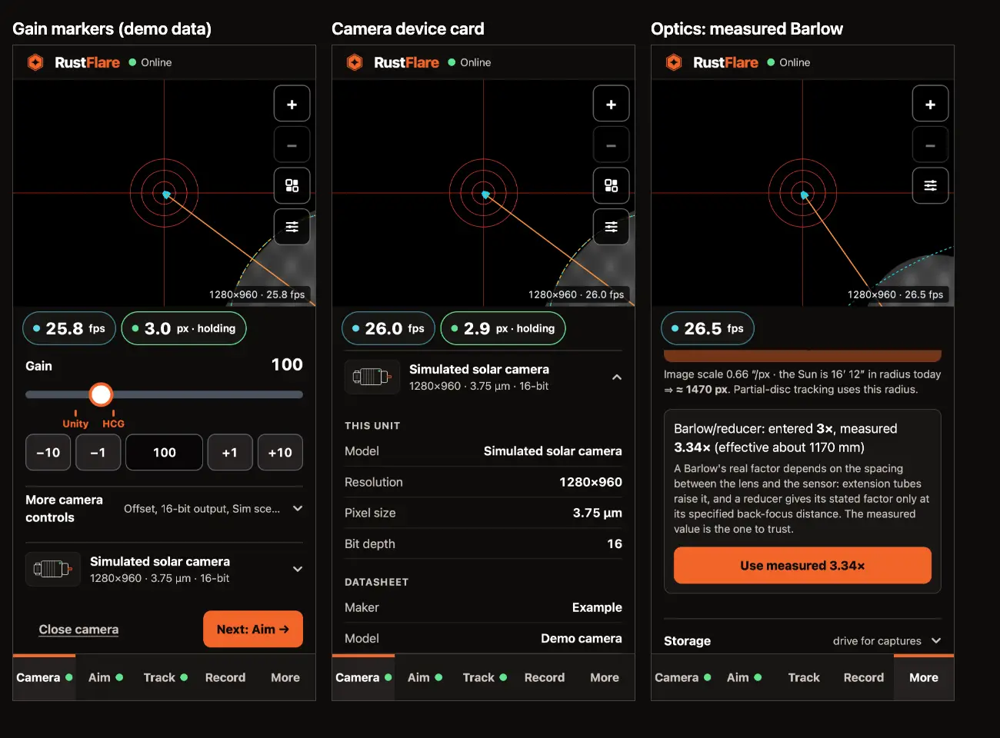
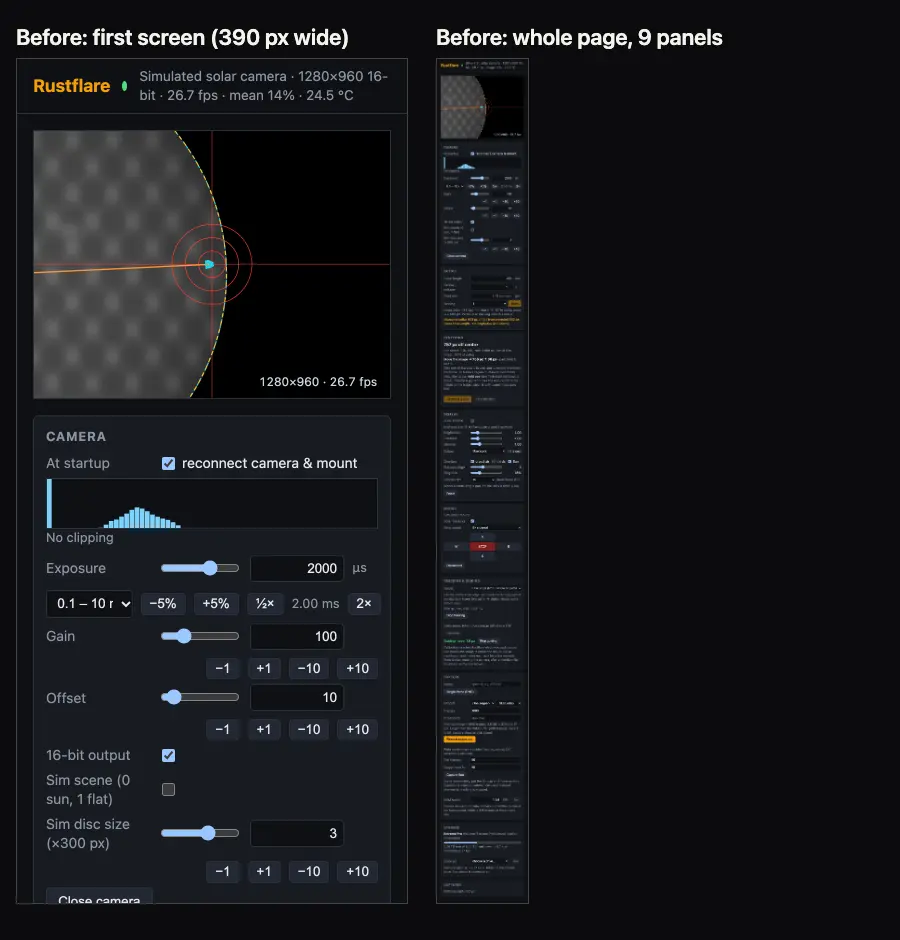

# Web UI review and redesign

The owner's verdict on the old UI was "way too complicated, I need something manageable". This page records the
critique, the new structure and the reasoning. Everything described here lives in `web/src`; the server and the HTTP
API are unchanged.

## Who and where

One person, outdoors at the telescope in bright daylight, mainly on a modern iPhone held one-handed (added to the Home Screen), sometimes a tablet or laptop, over Wi-Fi to a Raspberry Pi.
An H-alpha scope that shows part of the disc, a mono 16-bit camera, a ZWO AM3 mount. Most controls are set once;
during a session they need the live view, exposure and gain, tracking and guiding status, hold and stop, the slew pad,
and record and stop with progress. Flats are rare. This is an Operate surface: the job is to get the Sun framed and
recorded, so familiar controls and legibility beat expression.

## Critique of the old UI

Findings, most serious first.

1. **No hierarchy, no flow.** Nine panels (Camera, Optics, Centering, Display, Mount, Tracking & guiding, Capture,
   Storage, Captures) were stacked in one column in the order they were added, not the order they are used. A new user
   saw about 60 controls at once and had no way to tell the five that matter from the fifty that do not. On a phone the
   page was roughly 3,600 px tall, and the live view scrolled out of sight as soon as you touched anything.
2. **Set-once settings sat next to live controls.** Optics, storage, RAM buffer, flats, "reconnect at startup",
   preview fps and ring sizes had the same visual weight as exposure and the slew pad. Offset, 16-bit and the
   simulator's own controls were drawn like exposure.
3. **State was buried.** Clipping was a small line inside the Camera panel; "TARGET LOST" and guiding error lived in
   the Tracking panel; capture progress was at the bottom of the Capture panel, below the flats form. To check
   everything you scrolled the whole column.
4. **Two ways to do the same thing.** "Start guiding" (Tracking) and "Hold position" / "Centre & guide" (Centering)
   were separate buttons in separate panels with overlapping meaning; the prerequisites (tracking, mount solar
   tracking, calibration) were spread over both.
5. **Not usable on a phone in sunlight.** 14 px text, 20-30 px buttons, a thin 1 px-bordered dark-grey-on-black look,
   muted grey labels (about 4:1), slider thumbs the size of a fingertip, a slew pad whose buttons were about 36 px tall,
   and a 360 px right column that collapsed under the live view. Labels sat to the left of controls and squeezed them.
6. **Weak accessibility.** Checkboxes without associated labels, no focus ring beyond the browser default, no
   semantic structure, colour as the only signal for some states.

What worked and was kept: the live-view overlays (red bullseye, cyan Sun outline, tracker markers), the exposure
range window and fine buttons, the planning text for bursts and the RAM buffer, the FAT32 warning, and the plain
language of the help text.

## New information architecture

The screen is the live view, a status strip under it, and one panel with five tabs. The tabs follow the order of a
session and carry a status dot (ready, needs attention, problem, recording).

| Tab | Job | What is on it |
| --- | --- | --- |
| **Camera** | See the Sun, set exposure | Open camera (first run); histogram and clipping; exposure (range window, slider, typed value, half, 5 %, double); gain. "More camera controls" folds offset, 16-bit, and any driver-specific control. Close camera. |
| **Aim** | Get the region into view | Connect mount (first run); how far off centre and which pad buttons to hold; slew pad with STOP and speed; solar tracking switch; disconnect. |
| **Track** | Follow it and hold | Target (disc edge, feature, full disc); start tracking; then a three-line checklist: tracking, calibrate, hold position (Stop guiding when holding). "Centre the disc instead" and "When to recalibrate" are folded. |
| **Record** | Take data | Bursts every N seconds (default 100 frames every 30 s) or one sequence; planning text; format; where it is saving, free space, FAT32 warning; Start. Progress and Stop while recording. Name, single frame and recent captures are folded. |
| **More** | Set once | Display (auto-stretch, brightness, contrast, gamma, colour, invert, overlays, bullseye, preview fps), Optics (focal length, Barlow/reducer, pixel size, binning), Storage, RAM buffer, Flats, Startup (reconnect at startup). Each is one collapsed line with a summary. |

**Always visible**, whatever tab is open: the live view, a status strip with fps, a red **Clipping** chip, **No Sun
found**, **Mount tracking off**, **TARGET LOST** (also a badge on the image), **Holding, error in px**, calibrating,
and while recording a bar with burst, frames, next-in countdown, progress and a large **Stop**. Server errors show as
a banner. Chips are buttons that jump to the tab that fixes the problem. A "Next: ..." button ends each tab.

A first-time user sees the live view, five tabs and, on the Camera tab, one camera picker and one Open button: about
three controls. After opening the camera: exposure and gain, plus the tabs.

### Where each old panel went

| Old panel | Now |
| --- | --- |
| Camera | Camera tab (histogram, exposure, gain, more controls, close). "Reconnect at startup" moved to More, Startup. |
| Optics | More, Optics. A radius mismatch also shows on the Track tab and as "check radius" in More. |
| Centering | Aim tab (offset and pad hint); "Hold position" and "Centre & guide" moved to Track. |
| Display | More, Display. A button on the live view opens it. Zoom +/- buttons on the live view. |
| Mount | Aim tab (connect, solar tracking, slew pad, speed, STOP, disconnect). |
| Tracking & guiding | Track tab. The duplicate "Start guiding" is gone: "Hold position" is the same call. |
| Capture | Record tab; flats and RAM buffer moved to More. |
| Storage | One status line on Record (with the FAT32 warning); the chooser is in More, Storage. |
| Captures | "Recent captures" on the Record tab. |

## Design decisions

- **Look.** The brand's near-black warm ground with white text (muted text is about 9:1 on the ground, not 4:1), the brand
  orange as the one action colour that always means "the thing to press", red only for stop, error and the bullseye, green for
  healthy, cyan for information. State is never colour alone: chips and steps carry words and shapes. System fonts, so
  there is nothing to download over Wi-Fi.
- **Phone layout.** The live view is pinned at the top, the tabs are a bottom bar within thumb reach, and only the panel
  scrolls. No page-level scrolling, no horizontal scroll at 390 px. On laptops it is two columns with the tabs on
  top of the right column. Landscape phones and tablets use the two-column layout.
- **Touch targets.** 48 px minimum for controls, 68 px slew pad buttons, 60 px primary buttons, 44 px sliders with 32 px
  thumbs, labels above fields rather than beside them.
- **Slew pad.** Pointer down starts the slew, up, cancel, lost capture, window blur or leaving the tab stops it. The held
  button turns amber. Arrow keys do the same on a keyboard, but not while a field or the tab bar has focus. A separate STOP
  stops everything.
- **Progressive disclosure** with native `
`, so it is keyboard and screen-reader friendly and needs no
  JavaScript. Rare settings keep a one-line summary, so you can read the current value without opening them.
- **Track as a checklist.** The old panel asked you to infer the order. The new one shows tracking, calibration,
  hold, ticks the done ones, and puts the one useful button on the first unfinished line.
- **Accessibility.** Real labels for every field, tabs follow the ARIA tabs pattern (arrow keys, Home, End), visible 3 px
  focus rings, a live region that announces alerts (clipping, target lost), a skip link, reduced-motion respected.
- **Size.** No new dependencies and no service worker. The bundle went from 57.0 kB to about 67.7 kB gzipped JS and 1.5 kB to about 5.6 kB gzipped CSS; the icons add about 33 kB, loaded once.

## iPhone web app

The phone is the primary target; the laptop layout is the secondary one.

**Add it to the Home Screen.** Open the Pi's address in Safari (`http://astropi.local:8080`), tap Share, then Add to Home
Screen. It starts full-screen with the RustFlare icon, no browser bars, and works in portrait and landscape.
Set the phone's Auto-Lock to Never (Settings, Display and Brightness) for the session: the Pi serves plain HTTP, so there is
no service worker and no Screen Wake Lock (both need HTTPS; tracked separately). A one-line reminder is at the top of More.

What was done for it:

- **Layouts.** Portrait: live view on top, a compact task area below, a bottom tab bar in thumb reach. Landscape (phones
  and tablets): live view on the left, tabs and controls beside it. Wide screens: the same with a larger panel.
  `100dvh` everywhere, no page scroll, no horizontal scroll, no fixed-size panels.
- **Home Screen metadata.** `manifest.webmanifest` (standalone, theme and background `#0E0C0B`), `apple-mobile-web-app-capable`,
  `black-translucent` status bar, `viewport-fit=cover`, and `env(safe-area-inset-*)` padding for the notch, Dynamic Island
  and home indicator. Icons (180 touch icon, 192, 512, and a maskable 512 with a wide safe zone) are rendered from the
  owner's mark in `web/public/logo-mark.svg`, unaltered, on the brand dark ground.
- **Touch.** Every control is at least 44 pt (an automated audit over all tabs in both orientations found none smaller),
  `touch-action: manipulation` (no double-tap zoom), inputs at 16 px (iOS does not zoom on focus), no text selection or
  long-press callout on the pad, the live view or the widgets, no hover-only affordances.
- **Slew pad safety.** Hold to move; the slew stops on pointer up, pointer cancel, lost capture, window blur, page hidden,
  page hide, and when the Aim tab is left or the page unmounts. STOP is always one tap away. Verified with real pointer
  events in WebKit and Chromium: press sends speed 8, release sends 0, and a blur while held sends 0.
- **Sunlight.** White text on `#0E0C0B`, muted text about 9:1, the brand orange (6.2:1 on the ground) as the only action
  colour, with dark text on it. The few numbers that matter are large: fps, clipping percent, guiding error in pixels,
  frames recorded, all in the status strip under the picture.

## Mount state and Send home

The Aim tab shows what the mount itself reports (`status.mount`: tracking, slewing, at home, park, alt-az) as small tags
under the tracking switch, and the switch always follows `status.mount.tracking`, so pressing park or home on the mount
flips it. If the mount is parked (or parking) the pad and the tracking switch are disabled with "Parked on the mount: motion
is disabled", and the status strip shows "Mount parked". **Send home** asks for confirmation inline ("The mount will slew to
its home position. Make sure the telescope and cables are clear."), then posts `{"confirm": true}` to `/api/mount/home`; it
is disabled while recording or parked and shows the server's error text if it refuses. There is no park or unpark in the
app. A 400 "the mount is parked" from a slew or the tracking toggle is shown as it comes.

## Brand

The owner's mark is in the header next to "RustFlare" (system font, bold, tight tracking, "Flare" in the brand orange; the
wordmark font is not loaded because the Pi has no internet), and is the Home Screen icon. Brand orange `#F2652A` is the accent.
The red bullseye and crosshair, cyan Sun outline and tracker markers are unchanged: they are functional.

## Saved settings

Every value you tweak that should survive a reboot uses `useSetting` and so lives on the Pi, following you between phone
and laptop: slew speed, mount driver and serial device, selected camera, capture mode, format, frames, seconds, every,
bursts and name, flat settings, tracking target and radius, display preferences, last used tab (`ui.tab`), the expanded
section of More (`ui.more_open`) and the overlay widget layout (`hud.layout.phone` or `hud.layout.wide`). Zoom and pan are
per visit. Camera exposure, gain and offset are already saved per camera by the server.

## Overlay widgets on the live view

A button on the live view opens a small menu of widgets: **Recording** (state, burst n/N, frames, next burst in, file),
**Buffer** (RAM queue, disk MB/s, flushing), **Guiding** (state, the averaged error as a number, a one-minute error
sparkline, target-lost warning), **Histogram** (with the clipping warning) and a **Readout** (fps, exposure, gain).
Drag a widget anywhere inside the picture (finger or mouse), tap it to shrink it to one line, tap again to expand. Arrow keys
move a focused widget, Enter toggles. Positions are stored as fractions of the free space, so a widget always stays inside
the view whatever the screen shape. Widgets handle only their own pointer events, so dragging one never pans the image
and a drag on the picture never moves one; zoom, pan and tap-to-pick are untouched. Recording, buffer and guiding widgets
appear only while there is something to show. On a wide screen the defaults are recording, buffer and guiding in the
corners; on a phone nothing is shown until you turn it on. Rendering is cheap: a few small elements, the sparkline gets
one sample per 700 ms, and dragging updates CSS variables rather than React state.

## Device cards and gain markers

The Camera tab (below the controls) and the Aim tab (below the pad) each end with a collapsed device card: line-art
illustration plus a few facts, expanding to a datasheet written as a definition list. It reads
`GET /api/datasheet/camera` and `/mount` (planned, `{ live, catalog }`, every field optional) through one function,
`fetchDatasheet` in `web/src/datasheet.ts`; until the endpoints exist it falls back to a stub built from the live status,
so the card shows only what is known and says that no datasheet is available. Add `?datasheet=demo` to the URL to preview
the full card with clearly labelled placeholder values. If the catalog gives `hcg_gain` or `unity_gain`, the Gain slider
shows small HCG and Unity ticks. The illustrations in `web/public/devices` are original line art; a catalog `image`
filename overrides them.

## Measured Barlow or reducer factor

More, Optics compares the entered Barlow/reducer factor with the one the Sun's measured size implies
(`status.optics.suggested_multiplier`). If they differ by more than 3 %: "entered 3x, measured 3.34x (effective about
1170 mm)", a short explanation (a Barlow's real factor depends on the lens-to-sensor spacing, so trust the measurement) and
a **Use measured** button that sends the saved optics with only the multiplier changed. If they agree it says so quietly.
With no focal length entered but a suggested effective focal length it offers to set that (native = N, multiplier = 1). All
fields may be null. The More row summary says "Barlow measured 3.34x" when they differ.

## Before and after

The old page on the phone, cut off at the first screen on the left and whole on the right:

## How it was tested

Against the simulator only, with Playwright in WebKit (iOS Safari's engine) and Chromium, using the iPhone 15 Pro profile
at 393x852 and 852x393: every tab in both orientations has no horizontal or page scroll and no control under 44 pt;
the pad press, release and blur-while-held behaviour; hold-to-move; widget drag, clamping, tap-to-minimise, image pan not
affected both ways, and persistence across a reload; the Optics comparison with mocked statuses (differs, matches, no
focal length, all null).

## Not verified

Everything was exercised against the simulator only. Not seen: a real Player One camera's control list, the ZWO mount's
real `info` string, real FAT32 drives, a real iPhone (WebKit with the iPhone profile is close but is not the device: safe-area
insets, the Home Screen launch, the Dynamic Island, Safari's own bars and strong sunlight were not seen), a thumb hold on a
real screen (verified with pointer events), and the Optics comparison and datasheet cards against real server data (both
were driven by a mocked status and the placeholder fixture).
